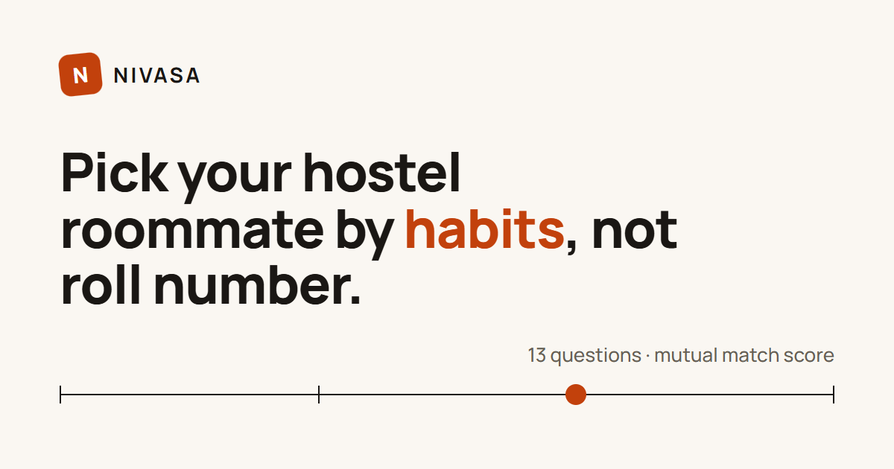
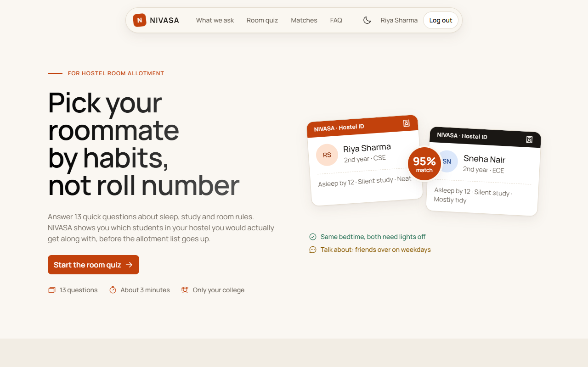
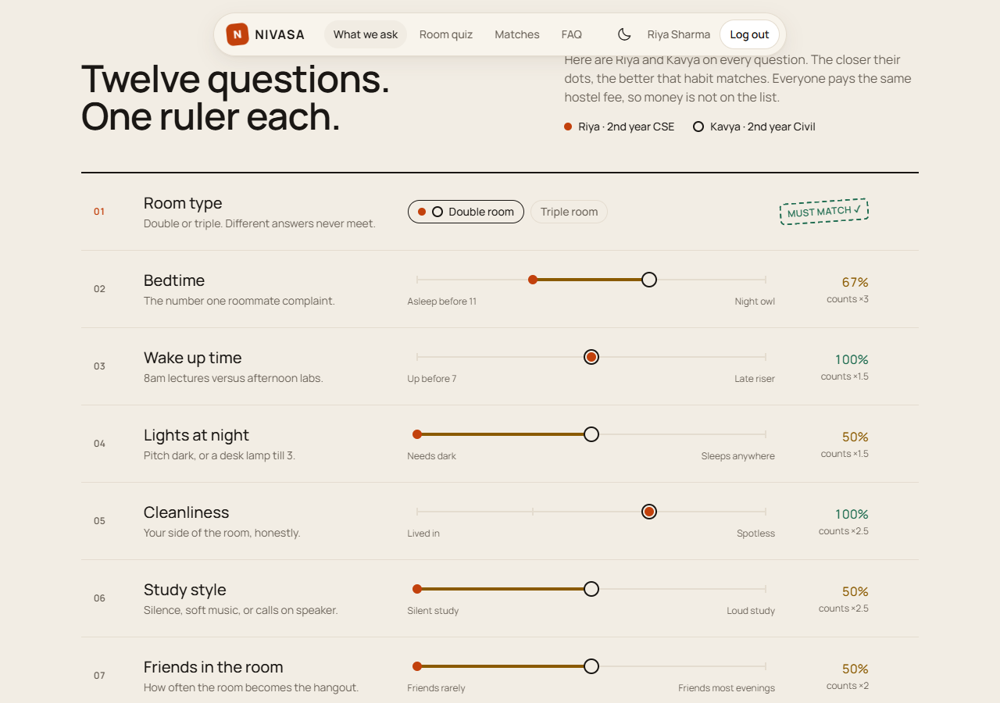
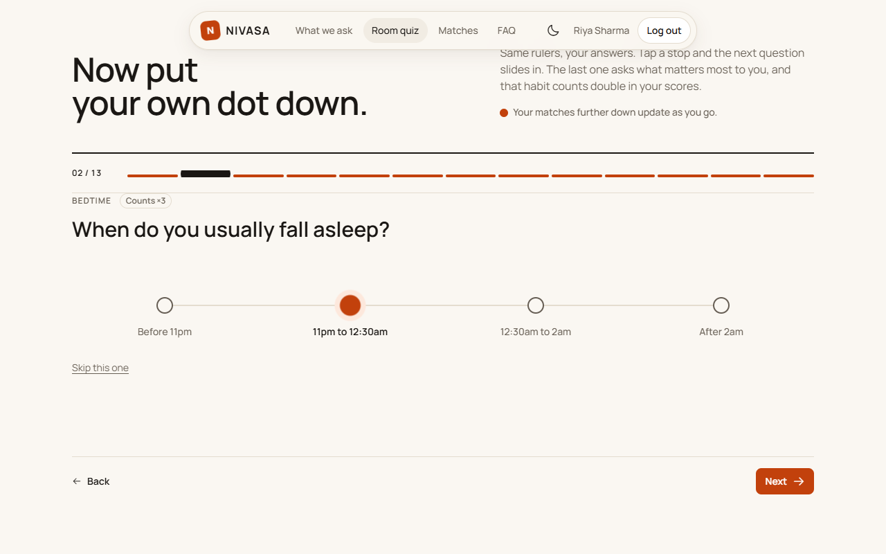
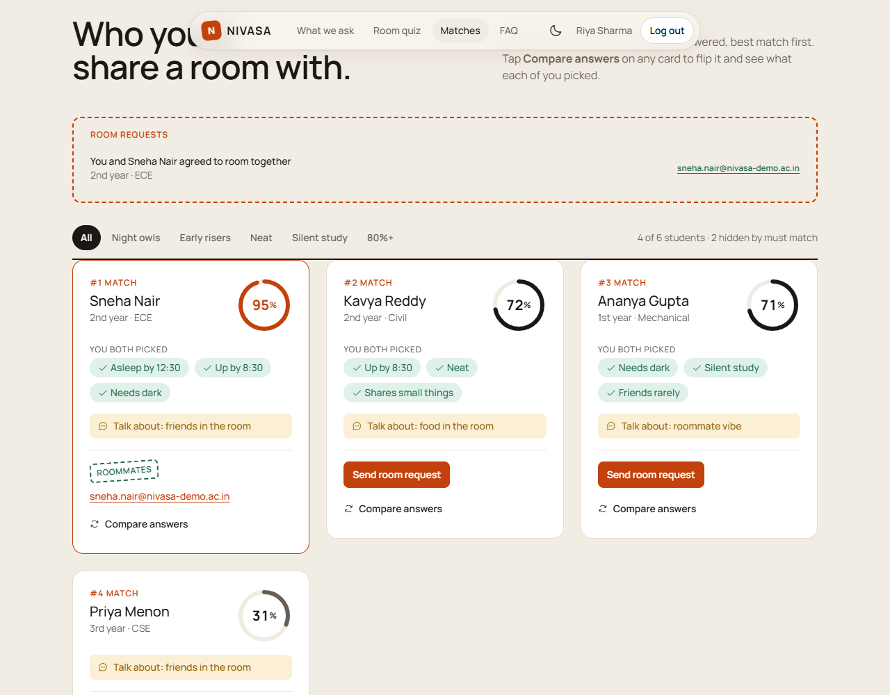
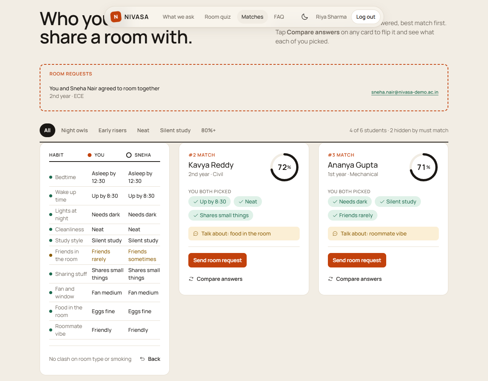
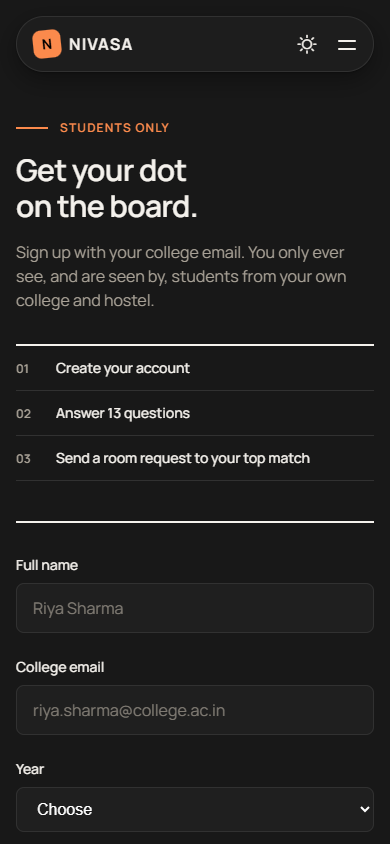
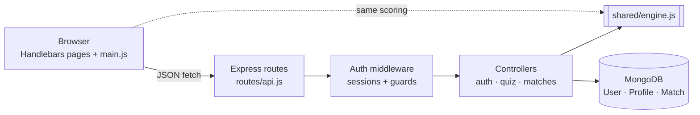

<p align="center">
  
</p>

<p align="center">
  <a href="https://github.com/Shaurya-Adhikari/PROJECT-NIVASA/actions/workflows/test.yml"></a>
  
  
  
  
  <a href="LICENSE"></a>
</p>

# NIVASA

Hostel roommates are usually decided by roll number. NIVASA lets students in
the same college and hostel answer **13 quick questions** about sleep, study
and room habits, then shows who they would actually get along with, with a
**mutual match score**, the reasons behind it, and a way to send a room
request.

Everyone in a hostel pays the same fee, so there is no budget filter. What
matters is habits, and two of them are deal breakers: **room type** (double or
triple) and **smoking** must match, or the pair is never shown.

## Watch the demo

A 70 second tour: the quiz, how two answers are compared, ranked matches and
room requests (sound on).

https://github.com/user-attachments/assets/82246f72-4ecf-4acb-9f50-1500b7f4ee00

## Screenshots

| Landing page | What we ask |
| --- | --- |
|  |  |
| **Room quiz** | **Ranked matches** |
|  |  |
| **Compare answers (card flipped)** | **Sign up on mobile** |
|  |  |

## Features

- **Habit quiz**: 12 habit cards plus "what matters most to you", one question
  at a time, saved as you go, works signed out too.
- **Mutual match score**: 0 to 100%, computed by one shared engine on both the
  server and the browser, so the number never disagrees.
- **Must-match rules**: a room type or smoking clash hides the pair completely.
- **Explained matches**: every card shows the habits you both picked and one
  thing to talk about first. Flip it to compare all answers side by side.
- **Filters**: night owls, early risers, neat, silent study, 80%+.
- **Room requests**: send, accept, decline or cancel. Emails are shared only
  after both students accept.
- **College only**: sign up needs a college email (`.ac.in`, `.edu`), and you
  only ever see students from your own college and hostel.
- **Accessible and polished**: light and dark themes, keyboard focus styles,
  reduced motion, Windows High Contrast support and a print stylesheet.

## How it fits together



The engine is a single file loaded with `require` on the server and with a
`<script>` tag in the browser, so the quiz preview and the real match feed
always score the same way.

## How matching works

1. **Must match cards** (room type, smoking) never add points. If they
   conflict, the pair is hidden from both feeds.
2. **Habit cards** score from 0 to 1 by distance: `1 − |a − b| / (options − 1)`.
3. **Weights**: bedtime 3, cleanliness 2.5, study 2.5, friends 2, wake up,
   lights, sharing and food 1.5, fan and vibe 1. Each person's "matters most"
   pick counts double for them.
4. **Mutual score** is the geometric mean of both directions,
   `√(A→B × B→A)`, so a match is only high if it works for both students.

### Worked example

Riya and Kavya both want a double room. Riya doesn't smoke and Kavya doesn't
mind, so neither must-match card blocks them. (If Kavya smoked, the pair would
be hidden, whatever their other answers.)

| Habit | Weight | Riya | Kavya | Similarity |
| --- | --- | --- | --- | --- |
| Bedtime | 3 | 11pm to 12:30am | 12:30am to 2am | 1 − 1/3 = 0.67 |
| Wake up | 1.5 | 7 to 8:30am | 7 to 8:30am | 1.00 |
| Lights at night | 1.5 | Fully off | Desk lamp fine | 1 − 1/2 = 0.50 |
| Cleanliness | 2.5 | Neat | Neat | 1.00 |
| Study style | 2.5 | Total silence | Soft music | 0.50 |
| Friends in the room | 2 | Sometimes | Sometimes | 1.00 |
| Sharing stuff | 1.5 | Small things | Small things | 1.00 |
| Fan and window | 1 | Medium | Medium | 1.00 |
| Food in the room | 1.5 | Eggs fine | Anything goes | 0.50 |
| Roommate vibe | 1 | Friendly | Friendly | 1.00 |

- **Riya's side.** Her top pick is bedtime, so it counts 3 × 2 = 6. Weighted
  total 16.25 out of 21, so **Riya → Kavya = 0.774**.
- **Kavya's side.** Her top pick is study style, so it counts 2.5 × 2 = 5.
  Weighted total 15.5 out of 20.5, so **Kavya → Riya = 0.756**.
- **Mutual score** = √(0.774 × 0.756) = 0.765, shown as **76%**.

The card then lists their best overlaps ("Same wake up time", "Same
cleanliness") and one gap to talk about first ("Talk about: food in the
room").

## Run it locally

```bash
npm install
npm run seed     # optional: adds 6 demo students
npm run dev      # http://localhost:3000
```

No MongoDB install is needed for development: without `MONGO_URI` the server
starts an embedded MongoDB that keeps its data in `.data/db`. To use Atlas or
a local `mongod`, copy `.env.example` to `.env` and set `MONGO_URI`.

To see the demo students as matches, sign up with any `@nivasa-demo.ac.in`
email and hostel `Girls Hostel A`.

```bash
npm test         # compatibility engine tests (Node 22+)
```

Tests also run automatically on every push and pull request through
GitHub Actions.

## Security

- Passwords are hashed with bcrypt (cost 12) and never returned by the API.
- The session is regenerated on sign in to prevent session fixation, and
  stored in MongoDB with an http-only cookie.
- Helmet sets a strict Content Security Policy and other security headers.
- Login and signup are rate limited.
- Quiz answers are sanitised by the engine: unknown keys and out of range
  values are dropped before saving.

## API

| Method | Path | What it does |
| --- | --- | --- |
| POST | `/api/auth/signup` | Create account (college email only), optional `answers` |
| POST | `/api/auth/login` | Log in |
| POST | `/api/auth/logout` | Log out |
| GET | `/api/me` | Signed in user and saved answers |
| GET | `/api/quiz` | Question set |
| PUT | `/api/quiz` | Save answers `{ answers: { bed: 1 } }`, `null` clears a card |
| GET | `/api/matches?filter=` | Scored students in your hostel. Filters: `night`, `early`, `tidy`, `silent`, `top` |
| GET | `/api/requests` | Incoming and outgoing room requests |
| POST | `/api/requests` | Send a request `{ to: userId }` |
| PATCH | `/api/requests/:id` | `{ status: "accepted" \| "declined" \| "cancelled" }` |

## Project structure

```
server.js              Express app: views, security headers, sessions, routes
config/db.js           MongoDB connection (embedded fallback in development)
models/                User, Profile (quiz answers), Match (room requests)
controllers/           auth, quiz, matches and requests handlers
middleware/            auth guards, error handling
routes/                api.js (JSON), pages.js (Handlebars pages)
shared/engine.js       Questions and compatibility engine (server + browser)
views/                 Handlebars layout, partials, home, login, signup, 404
public/                CSS, browser JS, favicon and share image
scripts/seed.js        Demo students
tests/                 Engine tests (node --test)
docs/                  Synopsis, progress report, timeline, screenshots
```

## Team

| Member | Area | Main files |
| --- | --- | --- |
| [Shaurya Adhikari](https://github.com/Shaurya-Adhikari) | Project lead · matching engine · match cards | `shared/engine.js`, `tests/`, `controllers/matchController.js`, `public/js/main.js` |
| [vinayakvaish05](https://github.com/vinayakvaish05) | Design system · themes · accessibility | `public/css/styles.css`, `views/layouts/`, `views/partials/` |
| [Mridul-Sahai](https://github.com/Mridul-Sahai) | Quiz and profiles · page routes | `models/Profile.js`, `controllers/quizController.js`, `routes/` |
| [Krishna-bit-shah](https://github.com/Krishna-bit-shah) | Accounts · login · security | `models/User.js`, `controllers/authController.js`, `middleware/` |

Built for CSE 2022 Web Programming, 2026–27. See [CONTRIBUTING.md](CONTRIBUTING.md)
for how we branch, commit and review.

## License

[MIT](LICENSE)
