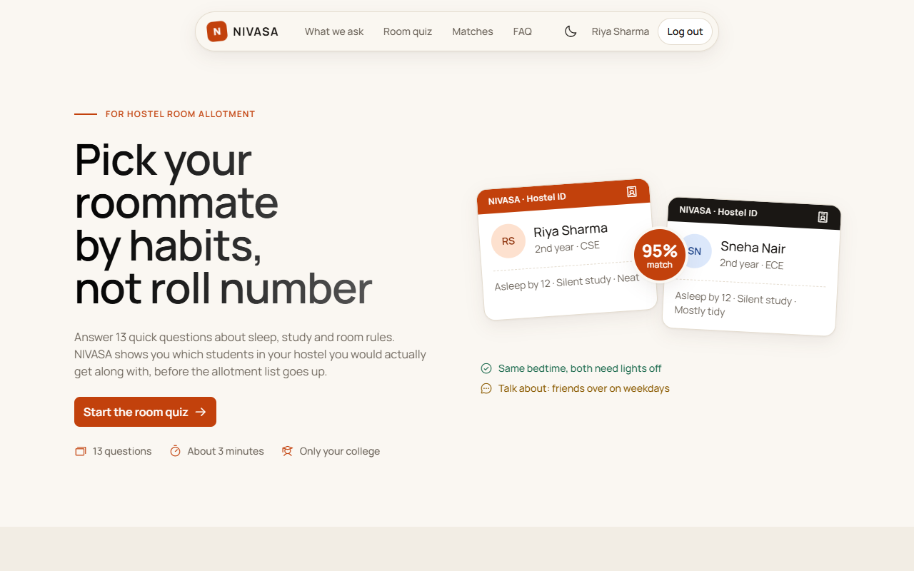
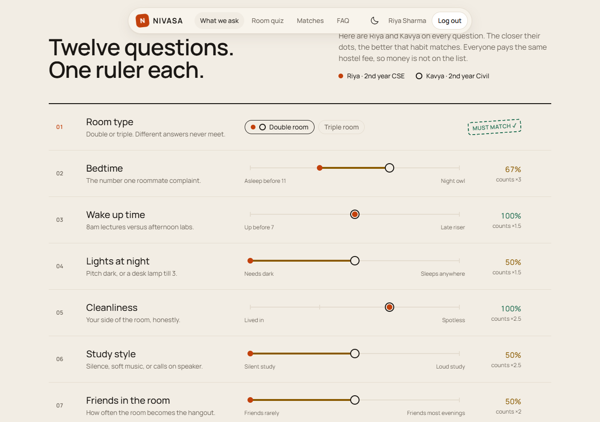
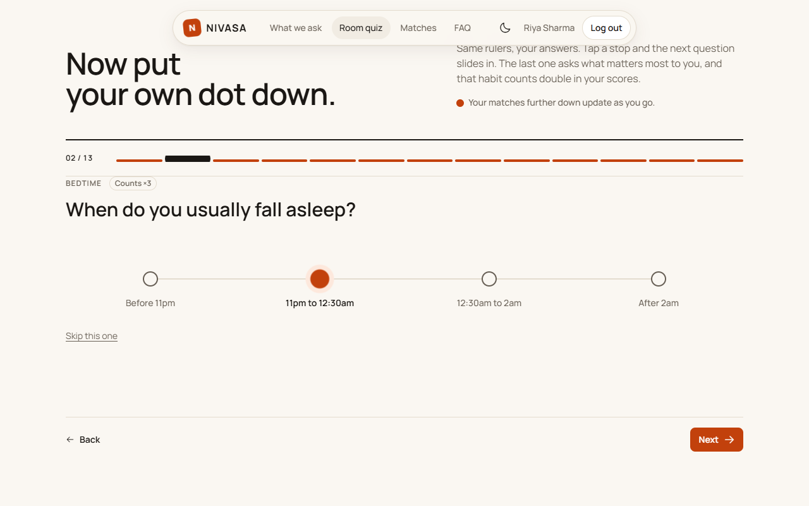
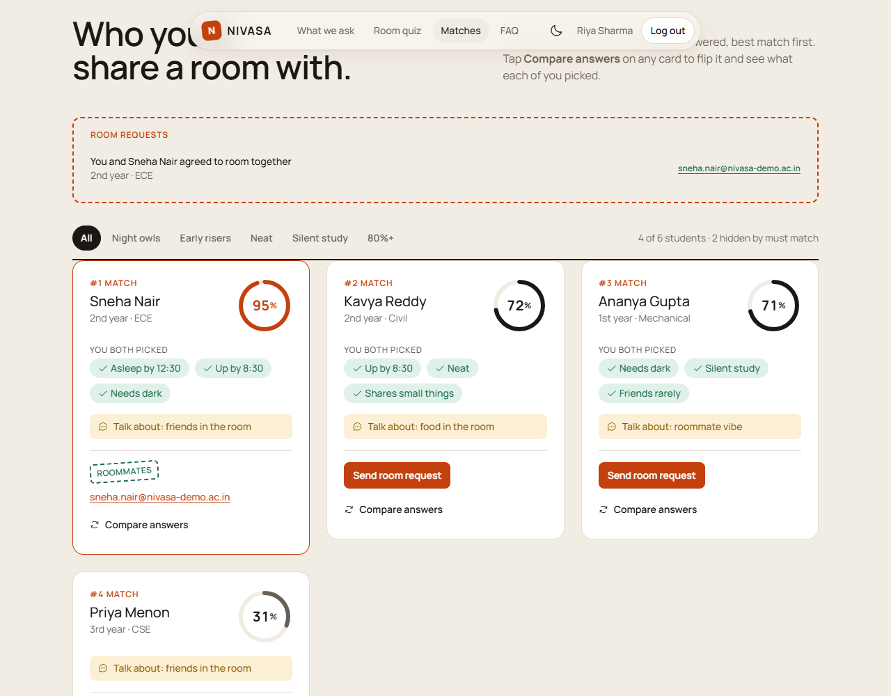
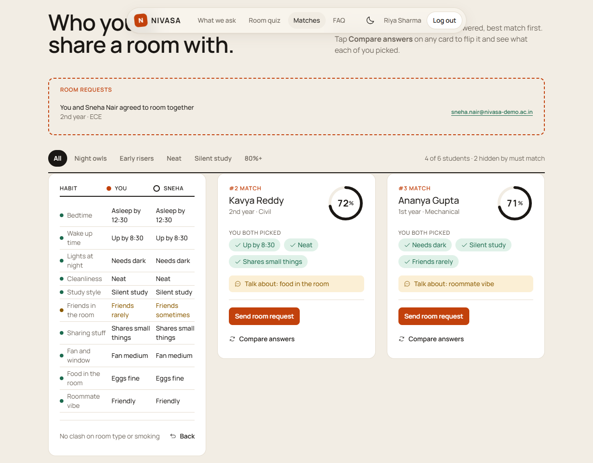
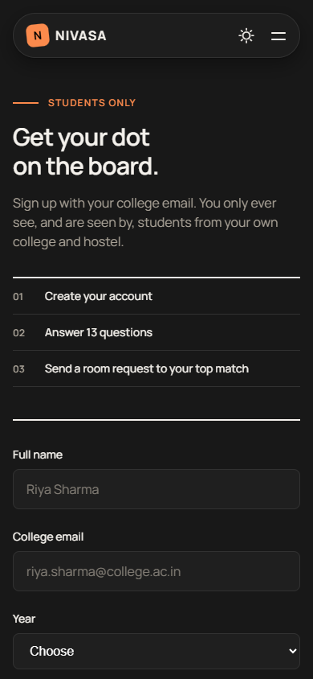

# NIVASA: Progress Report, Evaluation 2

**Team:** `[Team name]` · **Date:** `[dd Mon 2026]` · **Repository:** `[public GitHub link]`
**Run it:** `npm install` → `npm run seed` → `npm run dev` → open `http://localhost:3000`

## 1. Summary

NIVASA matches college students with hostel roommates using 13 quick questions about sleep, study and
room habits. For Evaluation 2 the JavaScript layer is complete:

- the quiz shows one question at a time,
- a compatibility engine scores every pair,
- a matches feed has filters and flip cards,
- the theme, menu and scroll effects work,
- the login and signup forms are validated.

All of it runs on plain JavaScript in the browser, with no framework. The backend for Evaluation 3
(Express, Handlebars, MongoDB) is also already working.

## 2. Evaluation 2 rubric → where it is in the code

| Rubric item | What we built | Where |
|---|---|---|
| **JavaScript syntax and concepts (10%)** | Objects and arrays for the question bank. Pure functions for scoring. `map` / `filter` / `reduce`, arrow functions, closures, `async`/`await`, `try`/`catch`, one module shared by browser and Node | `shared/engine.js` (`compatibility`, `similarities`, `directional`, `sanitize`) |
| **DOM manipulation (10%)** | Quiz screens built from data, summary list, match cards, skeleton loaders while loading, empty states, card flip, tagline that lights up word by word | `public/js/main.js`: `cardHTML`, `goTo`, `renderSummary`, `matchCardHTML`, `flip`, `renderFeed` |
| **Event handling (5%)** | `change` / `pointerdown` on answers (auto advance for mouse and touch only), `submit`, delegated `click` for filters and requests, `keydown` Escape for the menu, `matchMedia` change, `scroll` throttled with `requestAnimationFrame`, `IntersectionObserver` | `main.js` lines ~253–300 and ~483, `common.js` (`setMenu`, theme toggle), `auth.js` (`input`, `submit`) |
| **HTML, CSS and JS integration (5%)** | JS toggles classes and accessibility attributes (`aria-pressed`, `aria-expanded`, `hidden`, `inert`) and CSS animates them. The theme is saved in `localStorage` and applied before the first paint. Answers are saved locally when logged out and to the API when logged in | `common.js`, `theme-init.js`, `main.js` `queueSave` / `flushSave` |

**Form validation without `alert()`:** college email format, required fields and password length, with
error messages next to each field (`public/js/auth.js` → `validate`, `setError`).

## 3. Working prototype (screenshots)

| | |
|---|---|
|  |  |
| *Landing page* | *Every question shown as a ruler for two students* |
|  |  |
| *One question at a time, with a 13 step progress strip* | *Ranked matches, filters, room requests* |
|  |  |
| *Card flipped to compare answers* | *Signup with validation, 390px wide* |

**Demo flow for the viva (about 3 minutes):**
1. Answer a few quiz questions. Each answer slides to the next question and the matches below re-rank.
2. Change your bedtime to "After 2am" and show the scores dropping for early sleepers.
3. Pick "Triple sharing" and show students disappearing ("hidden by must match").
4. Use the filter chips, flip a card, and toggle dark mode.
5. Sign up with an `@nivasa-demo.ac.in` email and the hostel "Girls Hostel A", then send a room request.

## 4. Problems we hit and how we solved them

| Problem | Fix |
|---|---|
| Auto advancing after a pick broke keyboard use: arrow keys change a radio button and skipped the question | Auto advance only when the pick came from a `pointerdown` (mouse or touch). Keyboard users press Next or Enter |
| The score in the hero didn't match the score the engine calculated for the same two students | Moved all scoring into one shared file (`shared/engine.js`) that both the page and the server load |
| Text from users went into `innerHTML`, a cross-site scripting risk | Every value is escaped through `esc()` before it is inserted |
| The seed script lost the last record it wrote | Flush the database to disk before shutting down (`config/db.js`) |

## 5. Next steps (Evaluation 3)

- [ ] Push to a **public GitHub repo** and track tasks with **GitHub Projects** (required)
- [ ] Deploy with MongoDB Atlas
- [ ] Final report, presentation and contribution matrix
- [ ] Stretch: email verification, and letting a student report a profile

## 6. Individual contribution (Evaluation 2)

> Fill in honestly. The handout requires roles to rotate, and every member must be able to explain any part of the project.

| Member | HTML/CSS | JavaScript | Integration / docs | Can explain in viva |
|---|---|---|---|---|
| `[Member 1]` | `[ ]` | `[ ]` | `[ ]` | `[ ]` |
| `[Member 2]` | `[ ]` | `[ ]` | `[ ]` | `[ ]` |
| `[Member 3]` | `[ ]` | `[ ]` | `[ ]` | `[ ]` |
| `[Member 4]` | `[ ]` | `[ ]` | `[ ]` | `[ ]` |
